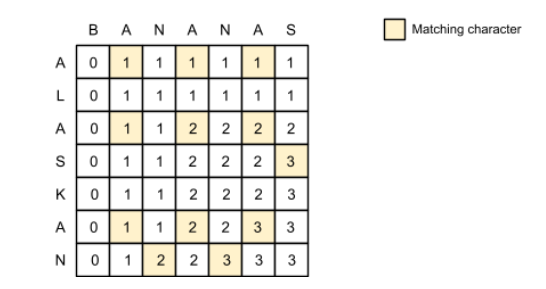
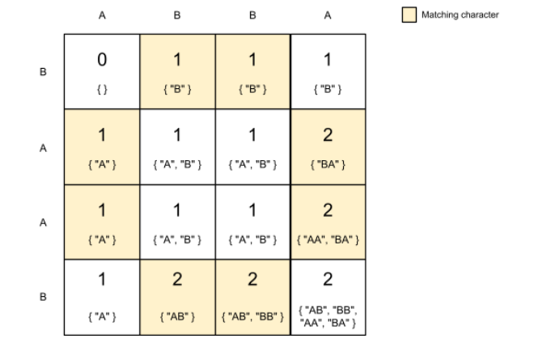

# 2.14 LAB: Longest common subsequence

## Overview

The longest common substring algorithm is presented elsewhere in this book.  The longest common subsequence algorithm is similar.  Unlike a substring, a subsequence need not be continuous.  Ex: "ARTS" is a subsequence of ALGORITHMS, but is not a substring.

A dynamic programming matrix can be used to solve the longest common subsequence (LCS) problem.  Rules for populating the matrix differ sligthly from the longest common substring algorithm.  Both algorithms populate rows from top to bottom, and left to right accross a row.  Each entry matrix[R][C] is computed as follows:

* if characters match, both algorithms assign matrix[R][C] with 1 + matrix[R - 1][C - 1].
* if characters do not match, the longest common....
    * substring: algorithm assigns matrix[R][C] with 0
    * subsequence: algorithm assigns matrix[R][C] with max(matrix[R - 1][C], matrix[R][C - 1])

Each algorithm uses 0 for out of bounds entries.  Ex: When computing matrix[0][0] for a character match, 0 is used instead of trying to access matrix[-1][-1].

## Sample Matrix

The image below shows the longest common subsequence matrix for strings "ALASKAN" and "BANANAS".  Entries corresponding to a character match are highlighted.

The largest number in the matrix indicates the length of the longest common subsequence.  Ex: The largest entry in the matrix above is 3, so the longest common subsequence between "ALASKAN" and "BANANAS" is 3 characters long.

## Multiple longest common subesquences

A pair of strings may have more than one longest common subsequence.  Ex: "ALASKAN" and "BANANAS" have three longest common subsequences: "AAA", "AAN", and "AAS".

## Step 1: Determine how to make the LCS set from the matrix

The matrix can be used to build a set of all longest common subsequences.  Before writing any code, consider two options for building the LCS set:

    1. Buld the entire numberical matrix, then traverse the matrix to build the LCS set.
    2. Build a matrix of structures that include the numberical entry plus the LCS set.

The figure below illustrates approach #2.

